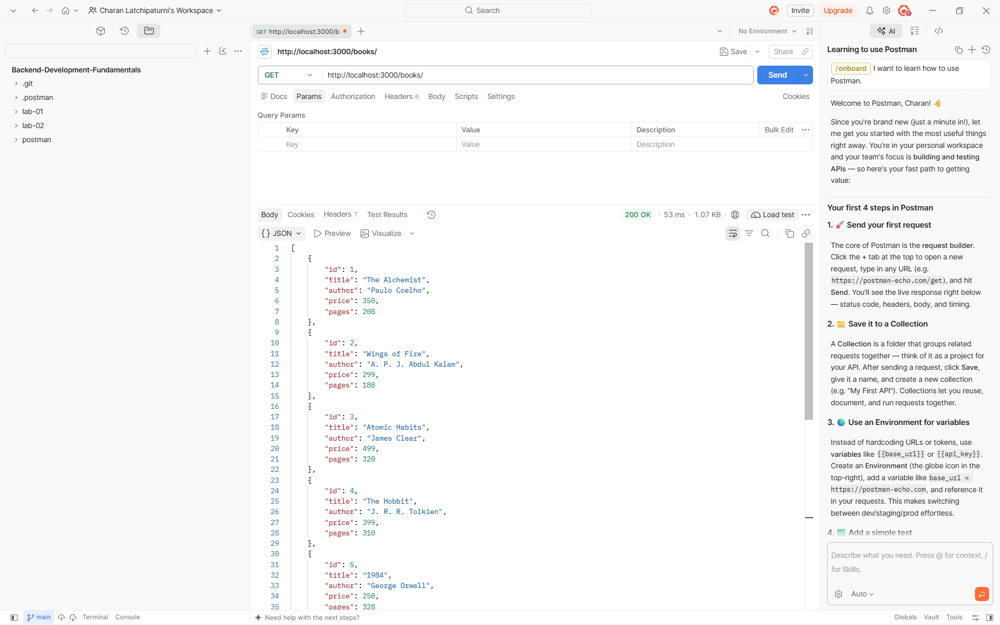
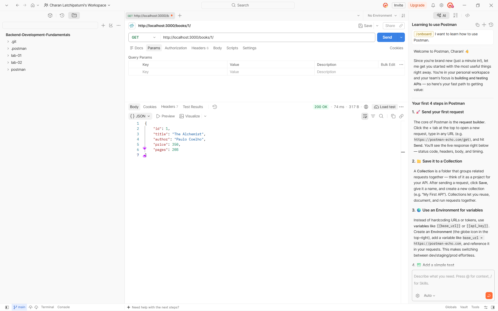
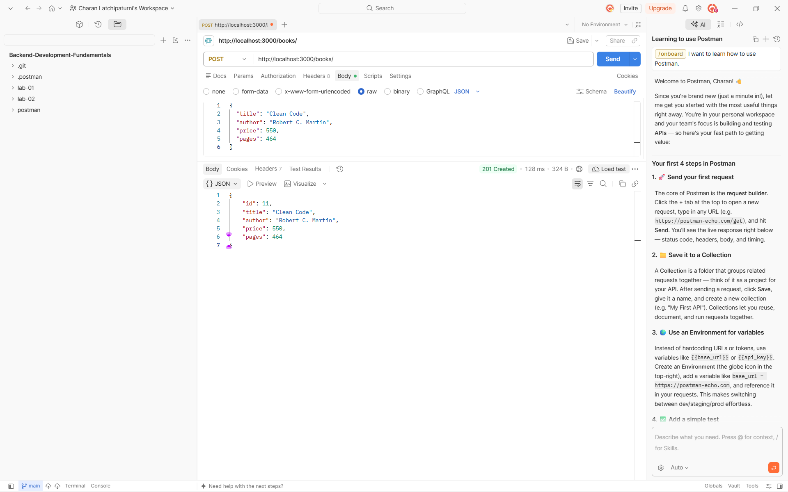
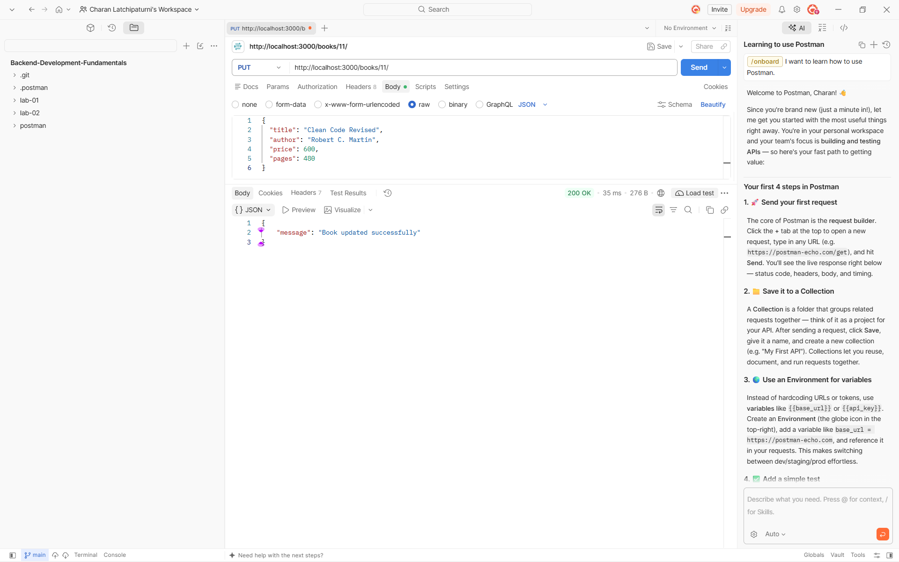
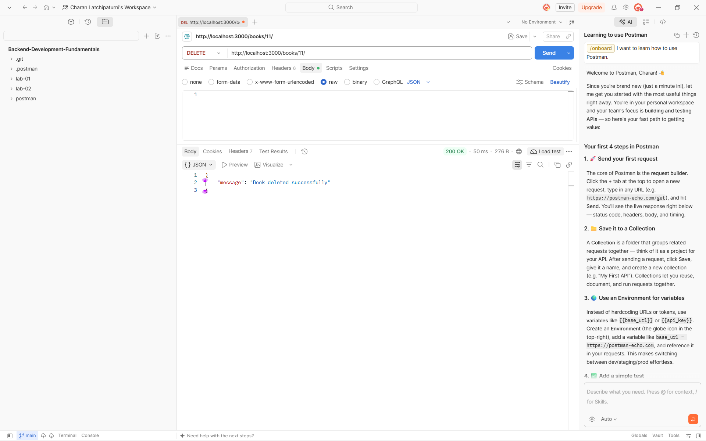
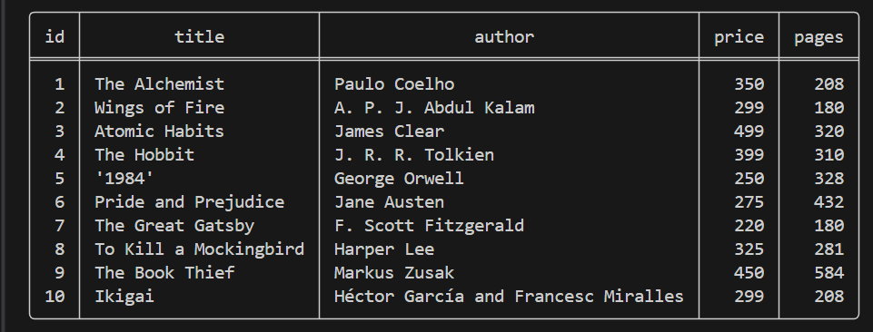

# Lab 2: SQLite database and CRUD routes

**Name:** SIVA MANIDHAR REDDY 
**Registration Number:** 252U1R8076 
**Class:** B.Tech CSE(QE) – 2B  
**Section:** S-13 204  
**GitHub Repository:** [backend_lab_2](https://github.com/sivamanidharreddy-cloud/backend_lab_2)  
**Deployment Status:** ✅ Successfully Deployed  
**Deployed Link:** https://backend-lab-2-1-jey7.onrender.com/books

## Objective

Connect an Express server to a SQLite database and expose CRUD operations over HTTP.

## Technologies Used

- Node.js
- Express.js
- SQLite
- `sqlite` and `sqlite3`
- Nodemon
- Postman
- Render (Production Cloud Deployment)

## Deployment Status & Verification

The backend service is successfully deployed to Render and configured for production:
- **Root Health Endpoint (`GET /`):** Confirms server status and returns available API routes.
- **Dynamic Port Management:** Uses `process.env.PORT` automatically provided by cloud hosts.
- **CORS Enabled:** Cross-Origin Resource Sharing is enabled for browser clients and Postman.
- **Persistent SQLite Database:** Pre-populated with 10 book records, with auto-table initialization if deployed to a fresh environment.

## Project Setup and Execution

1. Open a terminal in the project folder.
2. Install the project dependencies:

   ```bash
   npm install
   ```

3. Start the development server:

   ```bash
   npm run dev
   ```

4. Or start the production server:

   ```bash
   npm start
   ```

5. The server runs at:

   ```text
   http://localhost:3000
   ```

## Database

The SQLite database is located at `database/books.db`.

The `book` table contains the following columns:

| Column | Data Type | Description |
| --- | --- | --- |
| `id` | INTEGER | Primary key |
| `title` | TEXT | Book title |
| `author` | TEXT | Book author |
| `price` | INTEGER | Book price |
| `pages` | INTEGER | Number of pages |

The database was populated with 10 sample book records using the SQLite CLI.

## API Endpoints

| Method | Endpoint | Description |
| --- | --- | --- |
| GET | `/` | Health check and API routes directory |
| GET | `/books/` | Retrieve all books |
| GET | `/books/:bookId/` | Retrieve a book by its ID |
| POST | `/books/` | Add a new book |
| PUT | `/books/:bookId/` | Update a book by its ID |
| DELETE | `/books/:bookId/` | Delete a book by its ID |

For POST and PUT requests, send a JSON body containing `title`, `author`, `price`, and `pages`.

## Screenshots

### 1. Get all books



### 2. Get a book by ID



### 3. Add a book



### 4. Update a book



### 5. Delete a book



### 6. SQLite database records



## Problems Faced and Solutions

- The initial `package.json` file was empty. Added valid JSON before installing dependencies.
- The SQLite command-line tool was unavailable. Installed SQLite tools and verified the `sqlite3` command.
- Express was missing from the project dependencies. Installed it using `npm install express`.
- Hardcoded port 3000 prevented cloud deployment binding. Configured `process.env.PORT || 3000` to support Render.
- Added root health endpoint and CORS headers for testing from web clients.

## Notes

- SQL queries use `?` placeholders for user-provided values.
- The database connection is established before the Express server starts.
- `node_modules` and `.env` files are ignored via `.gitignore`.
